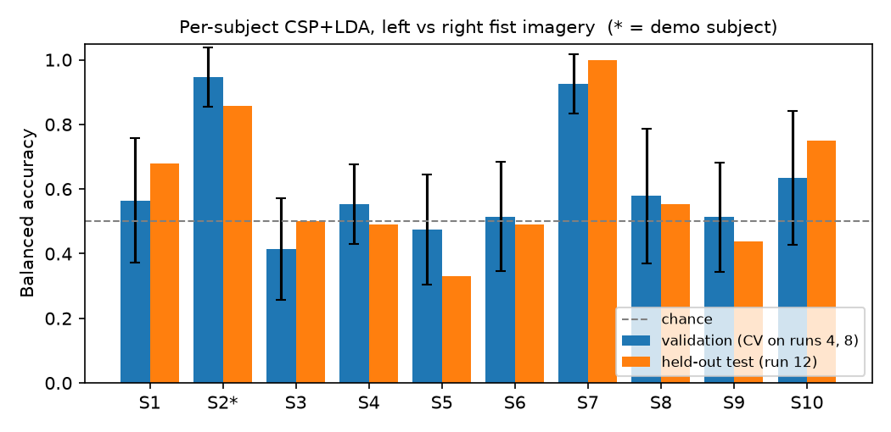
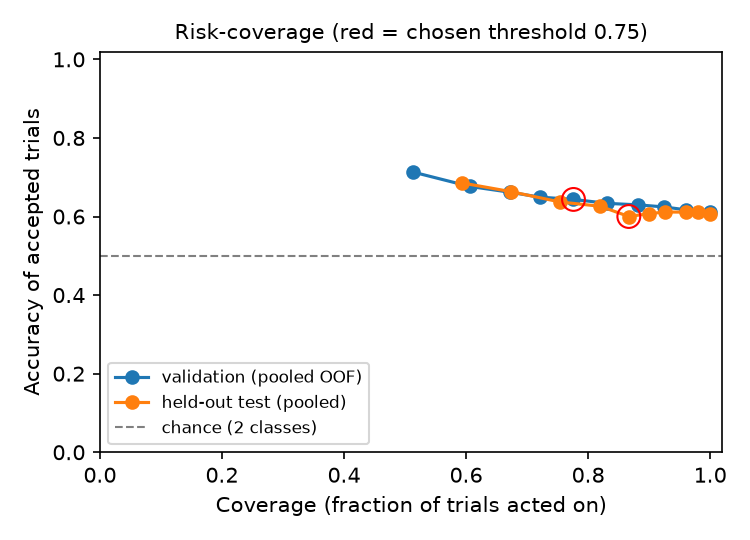
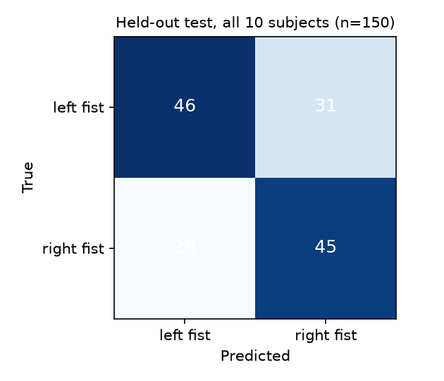
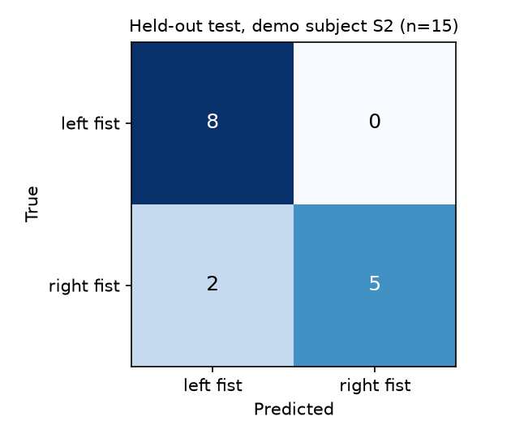
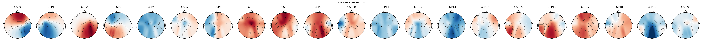

# NeuroBridge — Day-1 baseline results

_Generated 2026-10-14T16:40:21Z by `scripts/train.py` from `config/experiment.yaml`. All numbers below are actual outputs; nothing is illustrative._

## Setup
- **Dataset:** PhysioNet EEG Motor Movement/Imagery (EEGMMIDB) v1.0.0
- **Subjects:** S1, S2, S3, S4, S5, S6, S7, S8, S9, S10 (one model per subject)
- **Task:** left_fist_imagery vs right_fist_imagery (runs 4, 8, 12 = motor imagery)
- **Split:** train/validate on runs [4, 8], test once on run [12] — split by recording run, no window overlap
- **Channels:** 21 sensorimotor channels
- **Preprocessing:** 8.0–30.0 Hz Butterworth (order 4, zero-phase), window 0.5–2.5 s after cue
- **Model:** CSP (4 components, ledoit_wolf) + LDA · version `csp-lda-v1` · seed 42

## Held-out test (pooled over subjects)
| Metric | Value |
|---|---|
| Trials | 150 |
| Accuracy | 0.607 |
| Balanced accuracy | 0.607 |
| Macro F1 | 0.607 |
| Binomial p vs. chance (0.5) | 0.0056 |

## Abstention (threshold = 0.75, target not reachable on validation; fallback used)
| Split | Coverage | Abstention rate | Accuracy when acting | Error rate when acting |
|---|---|---|---|---|
| Validation (pooled OOF) | 0.78 | 0.22 | 0.643 | 0.357 |
| Held-out test | 0.87 | 0.13 | 0.600 | 0.400 |

Quality gate rejected 0 of 150 clean recorded test trials.

## Per subject
| Subject | Val bAcc (mean ± sd) | Test bAcc | Test n | Test coverage @thr | Test acc @thr | p vs chance |
|---|---|---|---|---|---|---|
| S1 | 0.56 ± 0.19 | 0.68 | 15 | 0.80 | 0.67 | 0.15 |
| S2 * | 0.95 ± 0.09 | 0.86 | 15 | 0.93 | 0.86 | 0.0037 |
| S3 | 0.41 ± 0.16 | 0.50 | 15 | 1.00 | 0.53 | 0.5 |
| S4 | 0.55 ± 0.12 | 0.49 | 15 | 0.93 | 0.43 | 0.7 |
| S5 | 0.47 ± 0.17 | 0.33 | 15 | 0.80 | 0.25 | 0.94 |
| S6 | 0.52 ± 0.17 | 0.49 | 15 | 0.60 | 0.56 | 0.7 |
| S7 | 0.92 ± 0.09 | 1.00 | 15 | 0.93 | 1.00 | 3.1e-05 |
| S8 | 0.58 ± 0.21 | 0.55 | 15 | 0.87 | 0.46 | 0.5 |
| S9 | 0.51 ± 0.17 | 0.44 | 15 | 0.93 | 0.50 | 0.7 |
| S10 | 0.64 ± 0.21 | 0.75 | 15 | 0.87 | 0.69 | 0.059 |

\* Demo subject S2 chosen by highest mean validation balanced accuracy (not by test score).

## Figures

## Limitations
- Very small per-subject data (~45 imagery trials); per-subject test sets have ~15 trials, so per-subject accuracies have wide uncertainty.
- Within-subject, within-session models only; no cross-subject or cross-day generalisation is claimed.
- The model score is LDA `predict_proba`; calibration has not been evaluated, so it is reported as a model score, not a probability.
- Recorded data from a public dataset; no live EEG is used.
- A motor-imagery class is a task-specific control signal, not decoded thought or language.
